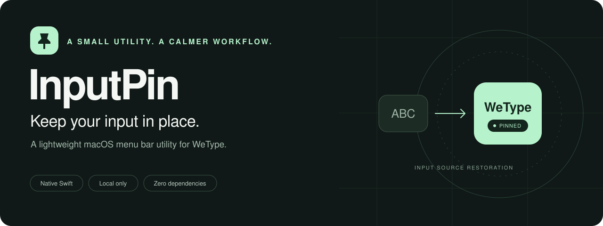

<div align="center">
  

  <p><strong>让微信输入法，留在你需要它的位置。</strong></p>
  <p>轻量 macOS 菜单栏工具 · 自动纠正输入源切换 · 原生 Swift · 零第三方依赖</p>

  <p>
    
    
    
    <a href="LICENSE"></a>
  </p>

  <p><strong>简体中文</strong> · <a href="docs/README.en.md">English</a></p>
  <p><a href="#快速开始">快速开始</a> · <a href="#工作方式">工作方式</a> · <a href="#常见问题">常见问题</a> · <a href="https://github.com/Daltan/InputPin/issues">反馈问题</a></p>
</div>

---

切换应用、切换窗口，准备继续输入时，输入法却跳回了 ABC。**InputPin 会在后台检查当前输入源，并在系统允许时自动切回微信输入法。** 你仍然可以在微信输入法内部切换中文和英文。

> **项目状态：早期版本，源码构建。** 当前仅支持微信输入法与 Apple Silicon。尚无预编译发行包、Developer ID 签名或公证；已验证项目和待验证场景见 [验证记录](VALIDATION.md)。

## 为什么使用 InputPin

| 能力 | 日常体验 |
| :--- | :--- |
| 自动恢复输入源 | 监听输入源与前台应用变化，配合每秒检查，自动纠正意外切换。 |
| 菜单栏随时控制 | 查看当前输入法和本次纠正次数，一键暂停或恢复；暂停状态跨重启保存。 |
| 登录启动 | 首次运行尝试注册登录项，可在菜单中关闭；系统可能要求批准。 |
| 尊重安全输入 | 安全输入期间暂缓切换，结束后恢复检查。 |
| 本地运行 | 无需辅助功能或键盘监控权限，不读取输入内容，应用无网络请求。 |
| 原生且小巧 | 使用系统框架与 Swift 构建，无第三方运行时依赖。 |

## 快速开始

### 1. 准备环境

- **Apple Silicon Mac，macOS 13 或更新版本**。当前构建目标为 arm64，暂不支持 Intel。
- 已安装微信输入法，并在 macOS 输入法设置中启用。
- 已安装 Xcode Command Line Tools；首次安装可运行 `xcode-select --install`。

### 2. 获取源码并构建

```sh
git clone https://github.com/Daltan/InputPin.git
cd InputPin
bash src/build.sh
```

构建产物位于 `outputs/InputPin.app`。脚本会完成本地 ad-hoc 签名、签名验证及 Info.plist 校验。

### 3. 放入应用程序并启动

将 `outputs/InputPin.app` 拖到「应用程序」目录，然后打开。菜单栏出现 **「微」与状态图标** 后，即可查看锁定状态、暂停保护或调整登录启动。

首次启动若提示登录项需要批准，请前往「系统设置 → 通用 → 登录项」允许 InputPin。建议先放入固定安装位置，再开启登录启动。

<details>
<summary>从「微信输入法锁定」原型迁移</summary>

先关闭旧原型的登录启动并退出，再使用 InputPin，避免两个实例同时纠正输入法。InputPin 使用独立的应用标识，旧设置不会自动迁移。

</details>

## 工作方式

```text
输入源 / 前台应用变化 ──→ 延迟合并检查 ─┐
                                      ├─→ 检查会话与安全输入状态
每秒定时检查 ─────────────────────────┘          │
                                                 ↓
                              系统允许且未暂停 → 自动切回微信输入法
```

InputPin 使用 macOS Text Input Sources API 查询和切换输入源。切换失败时会逐步延长重试间隔，最高为 30 秒；会话不活跃或睡眠期间暂缓检查。

**保护依赖切换后的纠正，存在短暂切换窗口。** 系统登录界面、密码框及限制第三方输入法的场景无法保证锁定。实际重启登录启动、睡眠唤醒和长期稳定性仍需验证。

## 常见问题

### 能锁定其他输入法吗？

当前只识别微信输入法（WeType），暂未提供自定义目标输入法功能。

### 微信输入法内部的中英文切换会受影响吗？

微信输入法内部的中英文切换保留。若需要使用系统 ABC 或其他输入源，请先在菜单栏选择「暂停锁定」。

### 为什么密码输入时没有切回来？

macOS 安全输入或特定输入框可能限制第三方输入法。检测到安全输入时，InputPin 会等待其结束再恢复检查。

### 菜单提示未找到微信输入法怎么办？

确认已安装并在系统输入法设置中启用微信输入法。可以通过菜单中的「打开输入法设置…」检查，再运行下方诊断命令查看可用输入源。

### 如何退出或卸载？

「退出」会停止本次运行的保护，之后登录仍遵循登录启动设置。卸载前，请先在菜单中关闭「开机启动」，退出应用，再将应用移入废纸篓。

## 诊断与验证

在源码目录中运行只读诊断：

```sh
outputs/InputPin.app/Contents/MacOS/InputPin --diagnose
```

输出包含输入源标识、名称、安全输入与登录项状态，不包含输入内容。提交反馈前请检查输出中是否包含你不希望公开的信息。

<details>
<summary>运行会切换输入法的集成测试</summary>

测试需要已登录的图形会话、已启用的微信输入法和 ABC，以及关闭安全输入。先退出所有输入法锁定实例，再运行：

```sh
outputs/InputPin.app/Contents/MacOS/InputPin --integration-test
```

测试会临时切换输入源，约需 5 秒，覆盖自动恢复、暂停与恢复锁定，不注册登录项。完整验证范围见 [VALIDATION.md](VALIDATION.md)。

</details>

## 参与贡献

欢迎提交可复现的问题、使用反馈及小范围改进。开始前请阅读 [贡献指南](CONTRIBUTING.md)；Pull Request 请附上变更原因和实际验证结果。

```text
InputPin/
├── src/main.swift       # 菜单栏、输入源检查、登录项与诊断
├── src/build.sh         # 构建、ad-hoc 签名与校验
├── docs/                # 英文说明与品牌素材
└── VALIDATION.md        # 已验证范围与待验证场景
```

## 许可与声明

以 [MIT License](LICENSE) 开源。InputPin 为独立社区工具，与腾讯或微信无关联。
