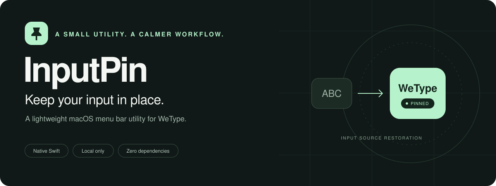

<div align="center">
  
  <p><strong>Keep WeType ready when you type.</strong></p>
  <p>Native Swift · macOS menu bar · No third-party dependencies</p>
  <p><a href="../README.md">简体中文</a> · <strong>English</strong></p>
</div>

---

InputPin watches the active macOS input source and switches it back to **WeType (微信输入法)** when the system permits. Chinese/English switching within WeType remains available.

> **Early-stage project. Build from source.** Currently supports WeType on Apple Silicon only. No prebuilt releases, Developer ID signing, or notarization are available. See the [validation record](../VALIDATION.md) for tested and unverified scenarios.

## Features

- Reacts to input-source and foreground-app changes, with a one-second fallback check.
- Menu bar controls for pause/resume, current source, and correction count. Pause state persists across launches.
- Attempts to enable launch at login on first run; can be disabled from the menu. System approval may be required.
- Defers switching during secure input, inactive sessions, and sleep.
- Requires no Accessibility or Input Monitoring permission. The app does not read typed content or make network requests.
- Built with Swift and system frameworks, without third-party dependencies.

## Get started

Requirements: an **Apple Silicon Mac running macOS 13 or later**, installed and enabled WeType, and Xcode Command Line Tools (`xcode-select --install` if needed). The build targets arm64; Intel Macs are not currently supported.

```sh
git clone https://github.com/Daltan/InputPin.git
cd InputPin
bash src/build.sh
```

Drag `outputs/InputPin.app` into Applications, then launch it. Look for **微** and a status icon in the menu bar. The app's menus are currently in Chinese: **暂停锁定** pauses protection, **恢复锁定** resumes it, and **开机启动** controls launch at login.

If approval is requested, allow InputPin in System Settings → General → Login Items. Install the app in its final location before enabling launch at login.

The build script applies a local ad-hoc signature and validates the signature and Info.plist. If migrating from the earlier “微信输入法锁定” prototype, disable its login item and quit it first. InputPin has a separate bundle identifier and does not migrate preferences.

## How it works

InputPin uses Carbon Text Input Sources APIs to inspect and select input sources. Event-driven checks and a periodic timer restore WeType after an unexpected switch. Failed attempts use increasing retry delays, capped at 30 seconds.

Correction happens **after** a source change, so a brief switching window remains. Login screens, password fields, and contexts that restrict third-party input methods cannot be guaranteed. Reboot/login behavior, sleep/wake behavior, and long-term stability still need verification for InputPin.

To use ABC or another input source, pause InputPin first. To uninstall, disable launch at login, quit the app, and move it to the Trash.

## Diagnostics

From the source directory:

```sh
outputs/InputPin.app/Contents/MacOS/InputPin --diagnose
```

This reports source identifiers/names, secure-input status, and login-item status without typed content. Review output before sharing publicly.

For the integration test, first quit all input-lock instances. It needs a logged-in graphical session, enabled WeType and ABC sources, and secure input disabled:

```sh
outputs/InputPin.app/Contents/MacOS/InputPin --integration-test
```

The test temporarily switches input sources for about five seconds and checks restoration, pause, and resume. It does not register a login item. Prototype results and InputPin validation are recorded separately in [VALIDATION.md](../VALIDATION.md).

## Contributing

See [CONTRIBUTING.md](../CONTRIBUTING.md) for the development workflow. Issues and pull requests in English or Chinese are welcome. The implementation lives in `src/main.swift`; `src/build.sh` handles building and signing.

## License

[MIT](../LICENSE). Independent community project; not affiliated with Tencent or WeChat.
